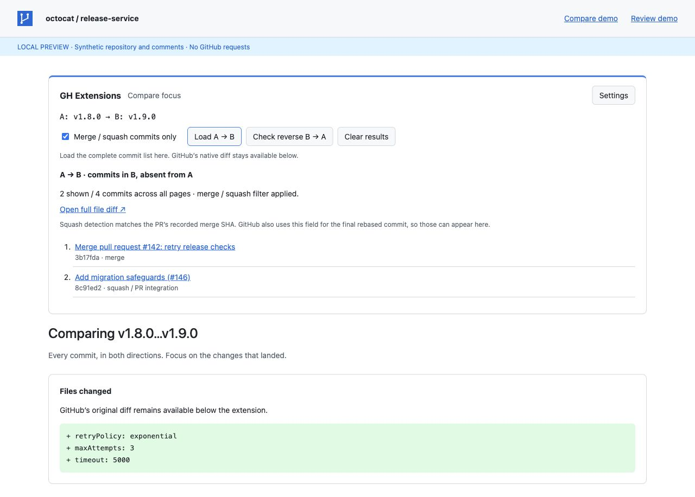
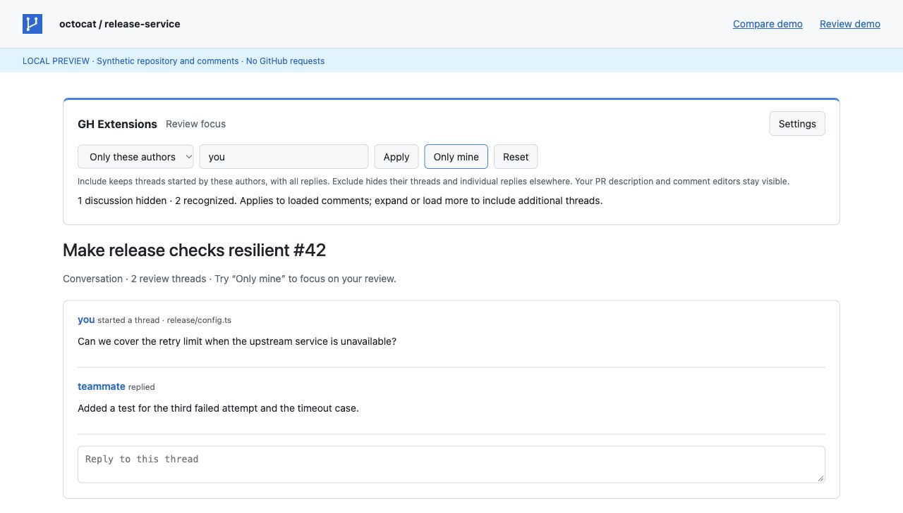

# GH Extensions

A small, dependency-free browser extension for focused GitHub comparisons and pull request reviews. One codebase, with Manifest V3 packages for Chrome and Firefox. Uses your existing GitHub website session: no PAT, OAuth app, or API permissions needed.



## Compare releases without the noise

On a `github.com/OWNER/REPO/compare/A...B` page, the **GH Extensions** toolbar adds:

- **Load A → B**: fetch every page of commits from the GitHub website. Enable **Merge / squash commits only** to omit intermediate work commits.
- **Check reverse B → A**: list commits reachable from A but absent from B, with a link to the reverse file diff. Useful for investigating changes that may have been left behind.
- Complete counts, commit links, and explicit errors when GitHub access, rate limits, or pagination prevent a complete result.

The complete list is rendered in the extension panel above GitHub’s native compare view. GitHub’s original commits and file diff remain available below. No page-by-page clicking is needed. Branch names are resolved to commit SHAs before pagination so a moving branch cannot mix multiple comparisons.

Merge commits are identified by multiple parents read from GitHub’s commit page. For a single-parent commit, the extension follows PR links exposed in the commit list/title or commit page and checks that the PR is merged and its recorded merge SHA equals the commit SHA. These entries are labeled **squash / PR integration**. Intermediate work commits are not included merely because they link a PR.

Squash detection has limits: an edited title with no exposed PR link may prevent classification, and GitHub’s recorded merge SHA can also identify the final rebased commit. The UI explains these limits. Disable the merge/squash filter to inspect every commit when completeness of classification matters.

Reverse comparison checks Git ancestry. A cherry-picked, squashed, or rebased equivalent can have a different SHA; a reverse-only commit is a candidate to investigate, not proof that its code is missing. This extension does not compute patch equivalence.

## Review the conversations you need

On a PR’s **Conversation** and **Files changed** tabs (including both `/files` and `/changes`):

- **Only these authors**: show threads started by the entered usernames, including all replies from everyone. Replying to somebody else’s thread does not make that thread yours.
- **Hide these authors**: hide their threads, standalone comments, and their individual replies inside other threads.
- **Only mine**: use the signed-in GitHub username as the include filter.
- **Reset**: restore every discussion.

Usernames are case-insensitive and may be separated by commas or whitespace. The filter is saved locally and reused when opening another PR or switching tabs. Already-open tabs refresh their filter on navigation or when Apply is used. The opening PR description and comment editors stay visible. Filtering changes only your local view; nothing is deleted or submitted to GitHub.

Both classic and current React review threads are supported. New comments loaded by GitHub are filtered automatically. Load or expand additional discussions as usual; the extension does not fetch hidden historical comments or bypass GitHub’s lazy loading. Unrecognized layouts remain visible, and the toolbar reports how many discussions it recognized. GitHub UI changes may require updates to `extension/review.js`.



## Install

Download the browser ZIP from [Releases](https://github.com/udayabharathi-t/gh-extensions/releases), or build from source:

```sh
npm ci
npm run build
```

### Chrome

1. Extract `gh-extensions-chrome.zip`, or use `dist/chrome` from a build.
2. Open `chrome://extensions`, enable **Developer mode**, and choose **Load unpacked**.
3. Select the extracted directory containing `manifest.json`.
4. Reload any GitHub tabs that were already open.

Requires Chrome 120 or later. The ZIP is an unpacked developer build, not a Chrome Web Store installation.

### Firefox

1. Extract `gh-extensions-firefox.zip`, or use `dist/firefox` from a build.
2. Open `about:debugging#/runtime/this-firefox` and choose **Load Temporary Add-on**.
3. Select `manifest.json` in that directory.
4. Reload any GitHub tabs that were already open.

Requires Firefox 140 or later. Temporary add-ons are removed when Firefox restarts. A persistent Firefox installation needs Mozilla signing and an XPI; the ZIP here is an unsigned development package. Store publishing and signing are not configured.

## No tokens or API permissions

All compare work runs in the content script in your GitHub tab. It uses read-only, same-origin requests to the GitHub website with your existing browser session, including the organization access you already have through SSO. The browser sends its normal cookies; the extension never reads, exports, or stores the session cookie.

The extension resolves refs through repository pages, follows GitHub’s compare commit-list pagination, and reads commit/linked PR pages to classify integration commits. It checks the collected count against GitHub’s summary and reports an error when it cannot verify a complete result. Clear results or navigating away cancels the operation.

No requests are made to `api.github.com`. No PAT, OAuth app, cookie permission, or external API host permission is requested. Repository content is held in the current tab’s operation memory, never persisted or sent to another service. Only your comment filter preferences are saved in local extension storage. Updating from v0.1 automatically removes any token previously saved by that version.

Private repositories work when they are accessible in the current GitHub browser session. If access fails, sign in and complete organization SSO normally. The extension does not bypass GitHub access controls. Large classifications require reading many commit pages; two requests run concurrently and fetched pages are reused within that operation. GitHub can still throttle website requests. Sign-in, layout, pagination, and rate-limit errors are shown explicitly.

## Development

Requires Node.js 22.12+ and npm. Packaging uses the `zip` command.

```sh
npm ci
npm test          # Session requests, pagination, classification, DOM filters, toolbar, navigation
npm run lint     # JavaScript syntax and generated manifest/resource checks
npm run package  # Build both browsers and create artifacts/*.zip
npm run preview  # Local demo with synthetic data at http://127.0.0.1:8765
```

Tests include a 321-commit comparison, reverse ref ordering, incomplete pagination, squash/PR association paging, sign-in and rate-limit errors, reply preservation, exclusion of replies, safe rendering, resets, and GitHub SPA navigation. The preview uses synthetic data and never calls GitHub. Automated tests use mocked page responses and DOM fixtures. Live public-page checks cover complete pagination and parent-based merge classification. Browser smoke tests should also be run after GitHub UI changes.

Runtime code has no third-party dependencies, remote scripts, telemetry, or analytics. Build/test dependencies are development-only. The extension runs only on `github.com`; self-hosted GitHub Enterprise domains are not currently supported. It requests storage for preferences and content-script access to `github.com`, with no cross-origin API access or write requests.

## Browser references

- [Content scripts and same-origin fetch in Manifest V3](https://developer.mozilla.org/en-US/docs/Mozilla/Add-ons/WebExtensions/Content_scripts#xhr_and_fetch)
- [Chrome content scripts](https://developer.chrome.com/docs/extensions/develop/concepts/content-scripts)
- [Firefox background script compatibility](https://developer.mozilla.org/en-US/docs/Mozilla/Add-ons/WebExtensions/manifest.json/background)

MIT licensed.
